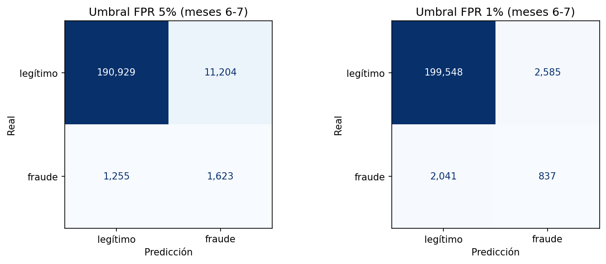
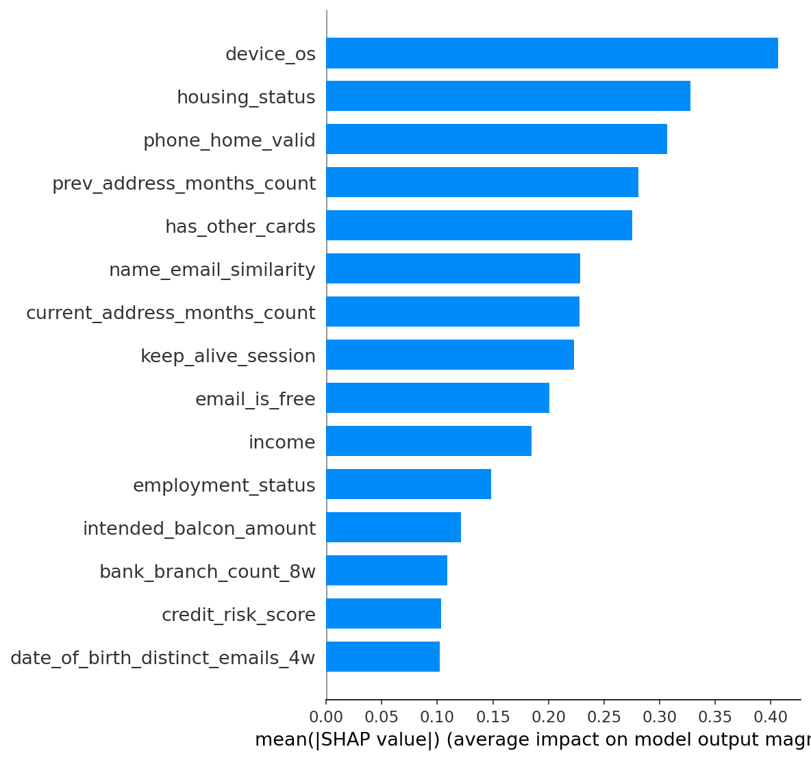
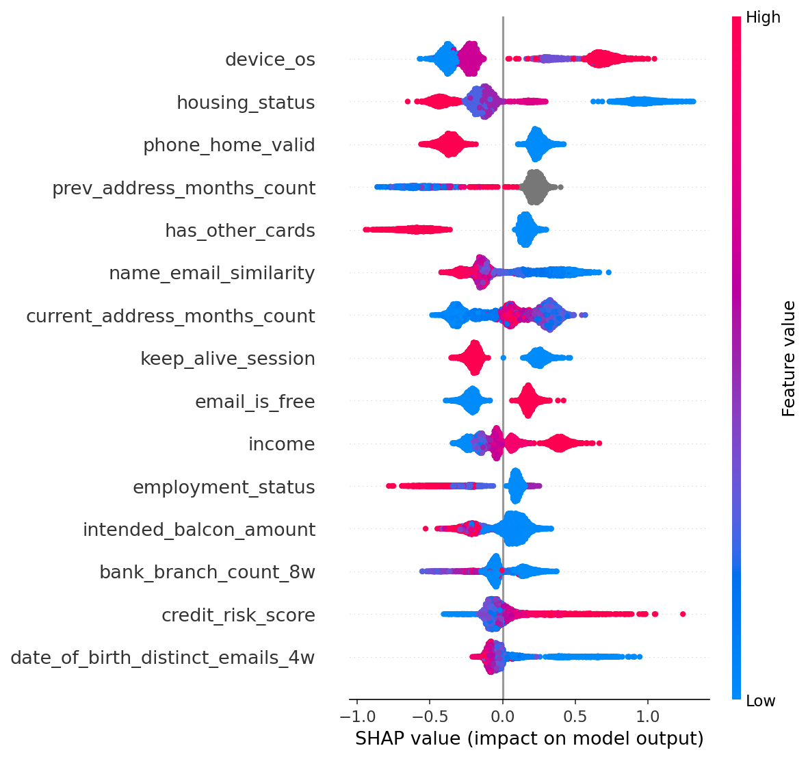
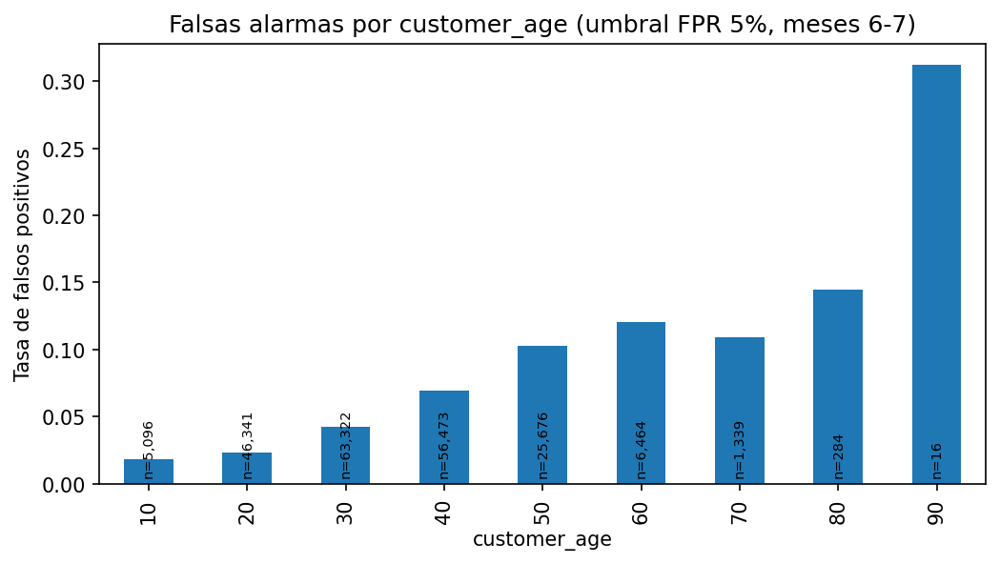
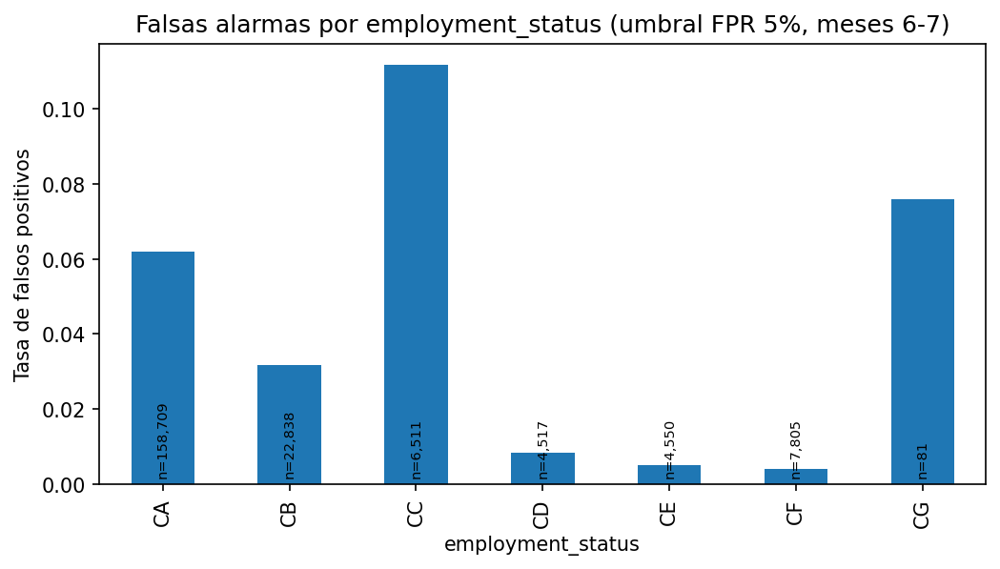

# Detección de fraude en apertura de cuentas (BAF)

> **English summary:** fraud detection on the Bank Account Fraud (NeurIPS 2022) dataset, with a
> temporal split, bank-style validation (Gini, KS, PSI), fairness checks and a FastAPI scoring
> service.

## Problema
El objetivo es detectar solicitudes fraudulentas de apertura de cuentas bancarias. El fraude es
poco frecuente (cerca del 1% de las solicitudes) y cada falsa alarma afecta a un cliente legítimo.
Por eso, además de Gini y KS, se mide cuánto fraude detecta el modelo (*recall*) con una tasa de
falsos positivos (FPR) limitada al 5% o al 1%.

## Datos
Se usa Bank Account Fraud (Feedzai, NeurIPS 2022), un conjunto de datos sintético generado a
partir de datos bancarios. No se incluye en el repositorio: descárgalo de la fuente oficial y
coloca `Base.csv` en `data/raw/`.

## Método
- **Partición temporal:** meses 0–4 para entrenamiento, mes 5 para validación y meses 6–7 para
  prueba.
- **Decisiones sin mirar la prueba:** las variables, el modelo, el calibrador y los umbrales se
  eligieron sin usar los datos de prueba.
- **Comparación de modelos:** la regresión logística con *splines*, LightGBM y XGBoost quedaron
  estadísticamente empatados; Random Forest fue el peor. El modelo final es LightGBM.
- **Variables descartadas:** `velocity_4w`, porque su deriva monótona la hace actuar como un reloj,
  y `customer_age`, por ser un atributo protegido. Quitarlas no cambió el Gini.
- **Calibración y umbrales:** calibración de Platt y umbrales según el FPR objetivo, ambos
  ajustados en validación.
- **Revisión del modelo:** deriva (PSI), explicabilidad (SHAP) y análisis de equidad.

## Resultados
| Métrica | Validación (mes 5) | Prueba (meses 6–7) |
|---|---|---|
| Gini | 0.788 | 0.784 |
| KS | 0.627 | 0.628 |
| Recall con 5% de FPR | 0.534 | 0.541 |
| Recall con 1% de FPR | 0.280 | 0.252 |

Al aplicar en la prueba los umbrales fijados en validación:

| FPR objetivo | FPR observado | Recall |
|---|---|---|
| 5% | 5.5% | 56.4% |
| 1% | 1.28% | 29.1% |

Estas cifras provienen del pipeline (`fraud.train`) y son las oficiales. El notebook de
exploración muestra valores ligeramente distintos.

## Figuras
Se generan a partir del modelo guardado con `python -m fraud.report`.

### Matriz de confusión
Aciertos y errores en la prueba con cada umbral.



### Explicabilidad (SHAP)
Qué variables pesan más en las predicciones y en qué dirección. Calculado sobre una muestra de
validación.





### Equidad
Tasa de falsas alarmas por grupo en la prueba, con el umbral de 5% de FPR. Los grupos pequeños
deben leerse con cautela.





## Limitaciones
- **Calibración:** sin calibrar, el modelo subestima el fraude. Platt lo corrige en el mes 6, pero
  en el mes 7, cuando el fraude llega a 1.47%, la probabilidad vuelve a quedarse corta. En
  producción habría que recalibrar periódicamente.
- **Deriva:** los umbrales se desvían entre 10% y 28% de su objetivo. `credit_risk_score` deriva
  con fuerza (PSI > 0.25), aunque pesa poco en el modelo.
- **FPR estricto:** con 1% de FPR, el recall es menor en la prueba que en validación.
- **Equidad:** quitar la edad redujo la brecha de FPR entre los 20 y los 60 años de unas 10 veces
  a unas 5, pero no la eliminó, debido a variables correlacionadas y a distintas tasas base.
- **Grupos pequeños:** las edades extremas y las categorías laborales CD, CE, CF y CG no permiten
  conclusiones fiables.

## Cómo reproducirlo
Desde la raíz del repositorio:

```bash
conda env create -f environment.yml
conda activate fraude-baf
pytest -q

python -m fraud.train              # entrena, valida y guarda artifacts/
python -m fraud.train --eval-test  # además reporta las métricas de prueba
python -m fraud.report             # genera las figuras
mlflow ui --backend-store-uri sqlite:///mlflow.db
```

## API
Requiere haber entrenado el modelo.

```bash
uvicorn fraud.api:app
```

La documentación interactiva queda en http://127.0.0.1:8000/docs, con los endpoints `GET /health`
y `POST /predict`.

## Estructura
- `src/fraud/`: datos, métricas, modelo, entrenamiento, reportes y API
- `tests/`: pruebas
- `notebooks/`: análisis exploratorio
- `reports/figures/`: figuras
